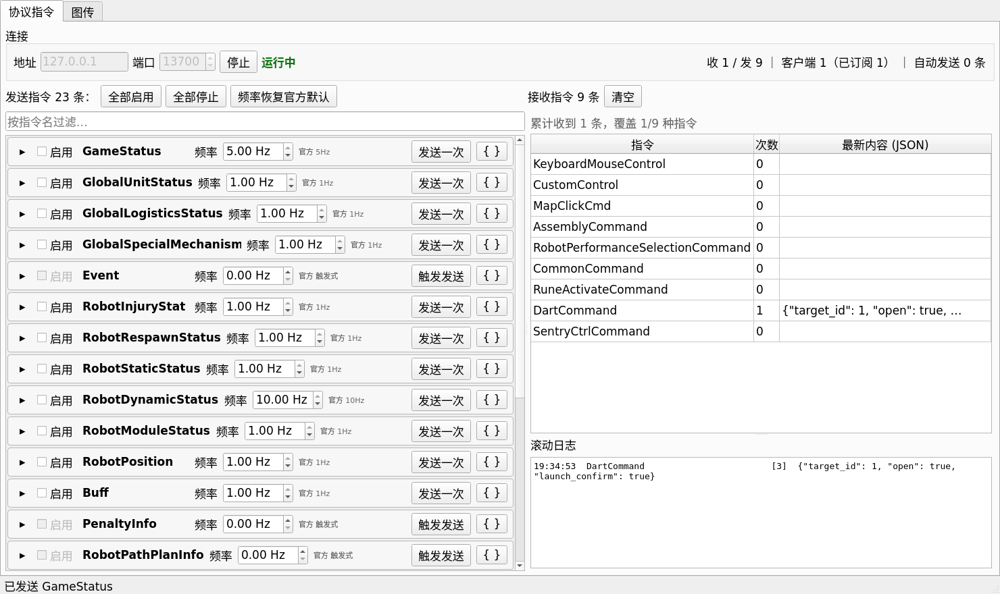
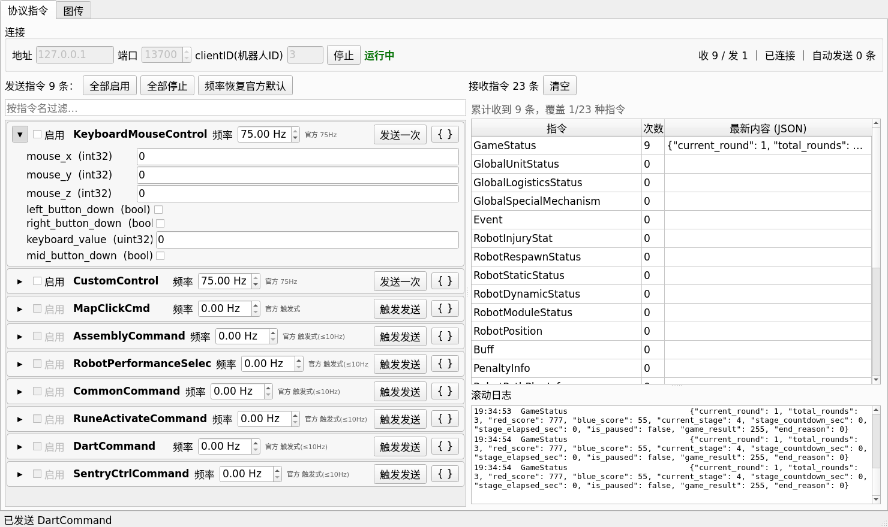

# RM2027 自定义终端协议后端

RoboMaster 2027 高校系列赛「自定义终端」通信协议的 C++ 实现，包含**自带 MQTT broker 的服务端**、
客户端、UDP 图传收发，以及 C / Python 接口和内置的 PyQt5 控制面板。

---

## 协议版本

| 项 | 内容 |
| :-- | :-- |
| 官方文档 | 《RoboMaster 2027 机甲大师高校系列赛通信协议 **V1.0.0**（20261029）》 |
| 协议章节 | 第 2 章「自定义终端协议」，**32 条指令**（上行 9 / 下行 23） |
| 传输格式 | Protobuf v3，要求 **≥ 3.15**（用了 proto3 `optional`） |
| MQTT | broker `192.168.12.1:3333`，qos 1，topic = 指令名；自定义终端 IP `192.168.12.2` |
| 图传 | UDP `3334`，HEVC/H.265，60fps，1920×1080，无重传 |
| UDP 包头 | 8 字节**大端**：帧编号(u16) + 分片序号(u16) + 当前帧总字节数(u32)；单包 ≤ 1400 B（负载 1392 B） |

> 本实现只针对 RM2027 V1.0.0 这一个版本，**不兼容 RM2026 协议**。
> 与 RM2026 V2.0.0 的逐条差异见 [docs/V1.0.0-变更分析.md](docs/V1.0.0-变更分析.md)。

---

## 已实现的功能

| 模块 | 能力 |
| :-- | :-- |
| 协议编解码 | 32 条指令的 proto 定义、消息注册表、二进制/JSON 互转；字段来自官方 PDF 字段表，与官方逐字段一致 |
| 服务器 | **自带最小 MQTT 3.1.1 broker**（零第三方 MQTT 依赖）；下行发布、上行接收；按类型/按名字回调；可获知发送方 clientID；上下线通知 |
| 客户端 | 基于 Paho MQTT C++；**自动重连**（指数退避 1s→5s）、断线后**重订阅**全部下行、`start()` 不阻塞、非阻塞发送（不等 PUBACK） |
| 图传发送 | BGR 图像 → HEVC 编码 → 分片 → UDP；码率/GOP/B 帧/intra-refresh/MTU 可配；故障注入（丢包/重复/乱序） |
| 图传接收 | UDP 重组 → 解码 → 最新帧槽位 + 统计；码流格式自动探测（h265/h264/jpeg）或手动固定；丢包后的恢复策略 |
| C++ 接口 | 3 个公开头文件，**不接触 protobuf / MQTT**；消息用 `std::unique_ptr<结构体>` 收发，类型安全 |
| C 接口 | `librm2027c.so`，57 个导出函数；指令内容用 **JSON 字符串**过 C 边界，ctypes / C# / Rust 均可调用 |
| Python 接口 | `rm2027c.py`（ctypes）；消息用 `dict`（snake_case 键名）；图传帧用 **numpy** 直接进出 |
| PyQt5 面板 | 服务器面板 + 客户端面板：逐条指令开关/频率/表单编辑/JSON 编辑/接收显示/批量操作/图传预览/主题跟随 |
| 命令行工具 | `rm_server`、`rm_client`、`rm_video_tx`、`rm_video_rx`，以及示例 `rm_api_demo` |
| 验证体系 | `bash tests/run_all.sh` 一键 11 项验证（协议 32 条逐字段、C 接口、API、Node 交叉验证、重连、GUI、图传、压力、字节序、端到端） |

---

## 构建（从拉取仓库开始）

### 1. 环境要求

| 依赖 | 版本 | 用途 |
| :-- | :-- | :-- |
| g++ | ≥ 11（C++17） | 编译 |
| CMake + make | CMake ≥ 3.16 | 构建系统（CMake 生成 Unix Makefiles） |
| protobuf | **≥ 3.15**（本项目用 3.21.12） | 协议序列化；Ubuntu 22.04 自带的 3.12.4 编不过 `optional`，用下面的脚本装 |
| Paho MQTT C++ | 1.2.0 | 客户端 |
| FFmpeg 开发库 | libavcodec / libavformat / libavutil / libswscale | 图传编解码 |
| Python 3 + PyQt5 + numpy | PyQt5 5.15+ | 仅控制面板 / Python 图传接口需要 |

```bash
# 系统依赖（Debian / Ubuntu）
sudo apt install -y build-essential cmake pkg-config \
                    libpaho-mqtt-dev libpaho-mqttpp-dev \
                    libavcodec-dev libavformat-dev libavutil-dev libswscale-dev \
                    python3-pyqt5 python3-numpy
```

### 2. 拉取仓库

```bash
git clone <仓库地址> RM2027-CustomTerminal-CommunicationBackend
cd RM2027-CustomTerminal-CommunicationBackend
```

### 3. 构建 protobuf（首次一次即可，不需 sudo）

```bash
bash third_party/fetch_protobuf.sh     # 下载 + sha256 校验 + 编译安装到 third_party/protobuf-21.12，约 2 分钟
```

> 脚本会用 `sha256` 校验官方发布包；网络不通时可手动下载 `protobuf-cpp-3.21.12.tar.gz` 后重跑。
> 若系统已有 protobuf ≥ 3.15，可跳过此步（构建会自动回退到系统版本）。

### 4. 构建本项目

```bash
bash build.sh                 # 等价于：cmake 配置 + make -j$(nproc)
bash build.sh -j4             # 指定并行度
# 或手动：
# cmake -S . -B build && make -C build -j"$(nproc)"
```

产物都在 `build/`：

| 产物 | 说明 |
| :-- | :-- |
| `build/rm_server` | 协议服务器（**自带 MQTT broker**，端口同官方 3333） |
| `build/rm_client` | MQTT 客户端（自动重连 + 重订阅） |
| `build/rm_video_tx` / `build/rm_video_rx` | 图传发送/接收工具（合成图案，不依赖 Python） |
| `build/rm_api_demo` | 对外 C++ API 最小示例 |
| `build/librm2027c.so` | 纯 C 接口动态库（Python ctypes 用它） |

> 两个常见问题：
> 1. 若 `build/` 是之前用 Ninja 生成的旧目录，先 `rm -rf build`，否则 `make` 找不到 Makefile。
> 2. 头文件 `protobuf` 版本 < 3.15 时编译会失败，请先跑第 3 步的脚本。

---

## 接口使用

### 1. C++ 接口

对外只需要三个头文件，**不接触 protobuf、不接触 MQTT**：

```cpp
#include <rm2027/api/messages.h>   // 32 条指令对应的原生结构体
#include <rm2027/api/client.h>     // 客户端
#include <rm2027/api/server.h>     // 服务器
```

角色说明：比赛中每个自定义终端本身充当**客户端**（连裁判系统服务器）；做本地联调时用本项目
自带的 `rm_server` 充当那个服务器。

#### 客户端（连真实裁判系统 / 连本地服务器）

```cpp
rm2027::Client::Options opt;
opt.host = "192.168.12.1";          // 本地联调填 127.0.0.1
opt.port = 3333;
opt.clientId = "3";                 // 官方规定：clientID = 机器人 ID
rm2027::Client client(opt);

// 收：按结构体类型绑定（推荐，类型安全）
client.on<rm2027::GameStatus>([](std::unique_ptr<rm2027::GameStatus> st) {
    printf("stage=%u red=%u\n", st->current_stage, st->red_score);
});

client.start();                     // 立即返回；连不上会后台自动重试，断线自动重连

// 发：构造结构体 -> 发送（指令名自动取自类型）
auto dart = std::make_unique<rm2027::DartCommand>();
dart->target_id = 1;
dart->launch_confirm = true;
client.send(std::move(dart));

client.runUntilStopped();
```

#### 服务器（本项目自带的 broker）

```cpp
rm2027::Server::Options opt;
opt.host = "192.168.12.1";
opt.port = 3333;
rm2027::Server server(opt);

server.on<rm2027::DartCommand>([](std::unique_ptr<rm2027::DartCommand> cmd) {
    printf("target_id=%u launch_confirm=%d\n", cmd->target_id, cmd->launch_confirm);
});
server.onAnyFrom([](std::unique_ptr<rm2027::Message> m, const std::string &clientId) {
    printf("%s from %s\n", m->name(), clientId.c_str());
});

server.start();

auto st = std::make_unique<rm2027::GameStatus>();
st->current_stage = 4;
st->red_score = 100;
st->game_result = 255;              // 官方约定：非结算阶段发 255
server.send(std::move(st));
```

#### 在自己的 CMake 工程里使用

直接 `add_subdirectory` 本仓库，然后链接对应目标（已实测可用）：

```cmake
add_subdirectory(path/to/RM2027-CustomTerminal-CommunicationBackend rm2027_backend)
add_executable(my_app main.cpp)
target_link_libraries(my_app PRIVATE rm2027_api_server rm2027_api_client)  # 只用一端就只链一端
```

可用目标：`rm2027_api`（消息与转换）、`rm2027_api_server`、`rm2027_api_client`、
`rm2027_video`（图传）、`rm2027_broker`、`rm2027_core`。

完整示例见 [examples/api_demo.cpp](examples/api_demo.cpp)，验证脚本 `bash tests/run_api.sh`。

### 2. C 接口

头文件 [include/rm2027/capi/rm2027_c.h](include/rm2027/capi/rm2027_c.h)，动态库 `build/librm2027c.so`。
设计：**指令内容一律用 JSON 字符串过 C 边界**（键名 = 官方 proto 字段名 snake_case），
所以 C 侧不依赖任何结构体布局，ctypes / C# / Rust 都能直接用。

```c
#include "rm2027/capi/rm2027_c.h"

static void on_msg(void *user, const char *name, const char *json, const char *cid) {
    printf("%s <- %s  (%s)\n", name, json, cid);
}

/* 服务器 */
rm_handle srv = rm_server_new("127.0.0.1", 3333);
rm_set_message_cb(srv, on_msg, NULL);
rm_server_start(srv);
rm_server_send(srv, "GameStatus", "{\"current_stage\":4,\"red_score\":100}");

/* 客户端 */
rm_handle cli = rm_client_new("127.0.0.1", 3333, "3");
rm_set_message_cb(cli, on_msg, NULL);
rm_client_start(cli);
rm_client_send(cli, "DartCommand", "{\"target_id\":1,\"launch_confirm\":true}");

/* 元数据：32 条指令 */
int n = rm_message_count();
const char *name = rm_message_name(0);
const char *fields = rm_message_fields_json(0);

/* 出错时取原因 */
printf("%s\n", rm_last_error());
```

编译链接（只静态使用一端时按需裁剪库）：

```bash
cc my_app.c -Iinclude -Lbuild -lrm2027c -Wl,-rpath,$PWD/build -o my_app
```

图传也有对应 C 函数（`rm_video_sender_*` / `rm_video_receiver_*`），用法见
[docs/README-full.md](docs/README-full.md) 第 4 节。导出符号共 57 个（36 个协议 + 21 个图传）。

### 3. Python 接口

[python/rm2027c.py](python/rm2027c.py) 用 ctypes 封装上面的 C 接口。需要先构建出 `build/librm2027c.so`。

```bash
export PYTHONPATH=$PWD/python     # 让 python 找到 rm2027c 模块
# 库默认按 python/../build/librm2027c.so 查找；放在别处时用环境变量指定：
export RM2027C_LIB=/path/to/librm2027c.so
```

```python
import rm2027c as rm

# ---- 客户端 ----
cli = rm.Client("127.0.0.1", 3333, client_id="3")
cli.on_message(lambda name, data, cid: print(name, data))
cli.start()
cli.send("DartCommand", {"target_id": 1, "open": True, "launch_confirm": True})

# ---- 服务器 ----
srv = rm.Server("127.0.0.1", 3333)
srv.on_message(lambda name, data, cid: print(name, data, cid))
srv.start()
srv.send("GameStatus", {"current_round": 1, "current_stage": 4, "red_score": 123})

# ---- 元数据：32 条指令 ----
for m in rm.messages():
    print(m.name, m.direction, m.frequency_text)
```

图传（numpy 直接进出，BGR24）：

```python
tx = rm.VideoSender("192.168.12.2", 3334, width=1920, height=1080, fps=60,
                    bitrate_kbps=8000, intra_refresh=True)
tx.start(); tx.send_frame(frame_bgr); tx.flush(); tx.stop(); tx.close()

rx = rm.VideoReceiver(port=3334, codec_mode=rm.CODEC_AUTO)
rx.start()
f = rx.get_frame()        # None = 没有新帧；否则 f.image 是 (h, w, 3) uint8
print(rx.stats)
```

> 回调在 C++ 的工作线程里执行。做 Qt 界面时请用信号转到主线程，不要直接操作控件
> （参考 [python/gui/bridge.py](python/gui/bridge.py)）。

---

## PyQt5 控制面板

内置两套面板：**服务器面板**（自带 broker，本机当裁判系统服务器用）和**客户端面板**
（连服务器，模拟自定义终端）。界面能力两边对称，只是收发方向相反。





### 启动

```bash
# 服务器面板：监听地址/端口可在界面上改
python3 python/run_server.py --host 127.0.0.1 --port 3333

# 客户端面板：clientID = 官方机器人 ID
python3 python/run_client.py --host 127.0.0.1 --port 3333 --client-id 3

# 主题默认跟随系统，也可强制
python3 python/run_client.py --dark
python3 python/run_server.py --light

# 库不在默认位置时指定
python3 python/run_client.py --lib /path/to/librm2027c.so
```

| 参数 | 适用 | 说明 |
| :-- | :-- | :-- |
| `--host` / `--port` | 两者 | 服务器=监听地址；客户端=broker 地址。默认 `127.0.0.1:3333` |
| `--client-id` | 客户端 | MQTT clientID = 机器人 ID（红方 1 重装 / 3-5 步兵 / 6 空中系统 / 7 哨兵；蓝方 = 红方 +100；2、102 为保留位） |
| `--dark` / `--light` | 两者 | 强制深色 / 浅色主题（默认跟随系统） |
| `--lib` | 两者 | 指定 `librm2027c.so` 路径 |

### 面板能做什么

| 功能 | 说明 |
| :-- | :-- |
| 逐条指令启用/停止 | 左侧每一条指令（服务器 23 条下行 / 客户端 9 条上行）各有一个面板和「启用」勾选框 |
| 发送频率 | 数值框，默认值取自官方表 2-1，旁边显示「官方 5Hz」作对照 |
| 触发式发送 | 频率设为 0 时按钮变为「触发发送」，点一次发一次 |
| 内容编辑 | 按官方字段表自动生成表单；bool 用复选框，bytes 支持文本或 `hex:00 11 22`，repeated 空格分隔，嵌套消息填 JSON |
| JSON 模式 | 每个面板右上角 `{ }` 可直接编辑整条指令的 JSON |
| 接收显示 | 右侧表格显示每条指令的次数 + 最新内容，下方滚动日志 |
| 批量操作 | 全部启用 / 全部停止 / 频率恢复官方默认 / 按名称过滤 |
| 状态栏 | 收发计数、连接状态；服务器侧显示「客户端 N（已订阅 M）」 |
| 图传标签页 | 服务器侧可读视频文件喂帧，客户端侧实时预览；端口/文件运行中禁用；解码格式可自动探测或手动固定；两侧预览可随时开关 |

> 联调建议：两个面板都开在本机（`127.0.0.1:3333`），先启动服务器面板，再启动客户端面板并填上
> 与服务器相同的端口，即可在两边看到完整的收发过程；图传用同一对面板的「图传」标签页即可预览。

### 命令行工具（无界面时）

```bash
./build/rm_server --list                       # 列出 32 条指令及方向
./build/rm_server --host 127.0.0.1 --port 3333 --scenario tests/scenarios/all_down.json
./build/rm_client --host 127.0.0.1 --port 3333 --client-id 3 \
                  --subscribe all --publish-scenario tests/scenarios/all_up.json --duration 10
./build/rm_video_tx --port 3334 --width 1280 --height 720 --fps 30 --duration 5
./build/rm_video_rx --port 3334 --duration 6 --dump /tmp/rx --dump-every 20
```

---

## 目录结构

```
CMakeLists.txt            CMake 构建定义（生成 Unix Makefiles）
build.sh                  一键构建：cmake + make -j$(nproc)
proto/                    proto 定义（由官方 PDF §2.2 提取，32 条）
include/rm2027/           公开头文件（api/ 为 C++ 接口，capi/ 为 C 接口）
src/                      实现 + CLI main
examples/api_demo.cpp     C++ 对外 API 最小示例
python/                   rm2027c.py（Python 接口）+ gui/（PyQt5 面板）
tests/                    验证脚本与场景数据（bash tests/run_all.sh）
docs/                     协议变更分析 / 移植说明 / 调研文档 / 归档的完整版 README
```

## 文档索引

| 文档 | 内容 |
| :-- | :-- |
| [docs/V1.0.0-变更分析.md](docs/V1.0.0-变更分析.md) | RM2026 V2.0.0 → RM2027 V1.0.0 的逐条协议差异与实现影响 |
| [docs/PORTING.md](docs/PORTING.md) | 从 RM2026 SDK 移植的过程、命名对照、重新生成协议数据的步骤、验证矩阵 |
| [docs/互操作验证-第三方实现.md](docs/互操作验证-第三方实现.md) | 与第三方开源实现的双向互操作验证（2026 V2.0.0 对照、schema 差异、结论） |
| [docs/README-full.md](docs/README-full.md) | 旧版完整 README（实现细节、验证方法、踩坑记录；已归档） |
| [docs/官方码流封帧调研.md](docs/官方码流封帧调研.md) | 官方图传封帧规则的原文核对 |
| [docs/UDP-字节序调研.md](docs/UDP-字节序调研.md) | 8 字节包头字节序的调研与实测 |
