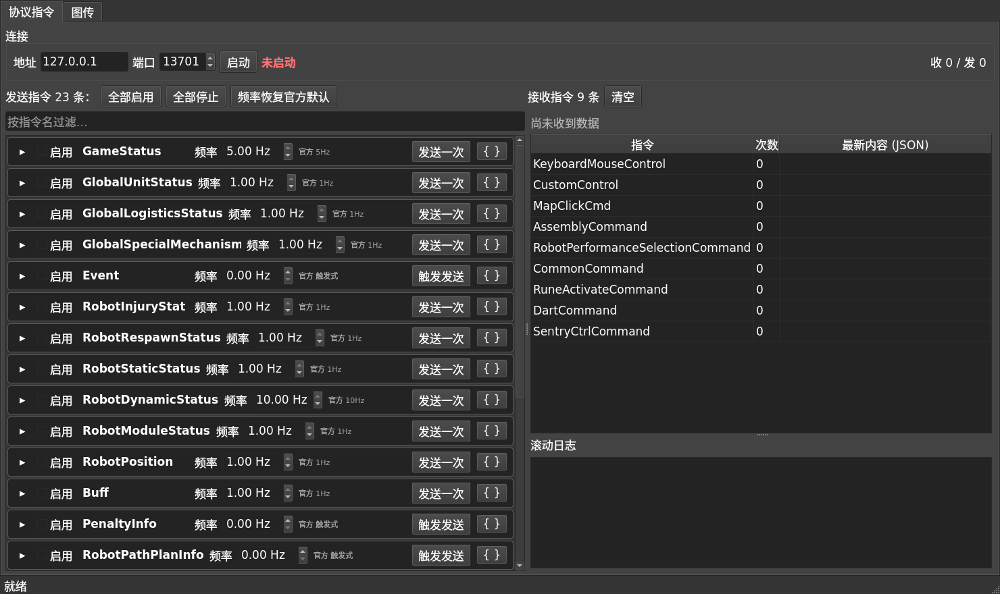

> **归档说明**：本文件是旧版完整 README，已从仓库根目录移入 `docs/` 归档，仅作实现细节备查。
> 入口文档请见根目录 [README.md](../README.md)。文中反引号内的路径仍按**仓库根目录**理解。

# RM2027 自定义终端协议 + 图传 —— C++ / C / Python 实现

按《RoboMaster 2027 机甲大师高校系列赛通信协议 **V1.0.0**（20261029）》实现的
自定义终端协议 + UDP 图传码流的 C++ 版本，含**自带的 MQTT broker**（零第三方 MQTT 依赖），
并与 Node（mqtt.js + protobufjs）实现做交叉验证。

本仓库由 RM2026 版 SDK（`rm2026-custom-client-protocol-sdk`）整体移植而来：目录 / 命名空间 /
库名 / 头文件由 `rm2026` 改为 `rm2027`，协议数据（proto、C++ 结构体、频率表）由 `tools/gen_*.py`
依据官方 2027 PDF 重新生成。相对 RM2026 V2.0.0 的逐条协议差异见
[docs/V1.0.0-变更分析.md](V1.0.0-变更分析.md)。

---

## 1. 目录结构

```
RM2027-CustomTerminal-CommunicationBackend/
├── CMakeLists.txt                  # CMake 构建定义（生成 Unix Makefiles，不用 Ninja）
├── build.sh                        # 一键构建：cmake 配置 + make -j$(nproc)
├── docs/PORTING.md                 # 从 RM2026 SDK 移植的说明（现位于 docs/）
├── examples/api_demo.cpp           # C++ 对外 API 最小示例（只用公开头文件）
├── python/                         # Python 层 + PyQt5 控制面板
│   ├── rm2027c.py                  #   ctypes 封装 librm2027c.so
│   ├── capi_test.py                #   C 接口功能验证
│   ├── gui_headless_test.py        #   离屏 GUI 功能验证
│   ├── gui_screenshot.py           #   离屏截图（无显示器时检查布局）
│   ├── run_server.py               #   启动服务器控制面板
│   ├── run_client.py               #   启动客户端控制面板
│   └── gui/                        #   界面组件（bridge / 表单 / 面板 / 接收视图 / 主窗口）
├── docs/
│   ├── images/                     # README 里用到的截图（定稿入库；由测试产物同步而来）
│   └── *.md                        # 协议变更分析 / 字节序调研 / 官方封帧调研
├── third_party/                    # 第三方依赖（二进制不入库，见其中 README）
│   ├── README.md                   #   依赖清单 / 许可证 / 获取方式
│   ├── fetch_protobuf.sh           #   下载 + 校验 + 编译安装 protobuf
│   └── LICENSE.protobuf            #   protobuf 的 BSD-3-Clause 许可证
├── proto/
│   ├── rm2027_client_up.proto      # 上行 9 条（自定义终端 -> 服务器），自官方 V1.0.0 PDF §2.2 提取
│   ├── rm2027_client_down.proto    # 下行 23 条（服务器 -> 自定义终端）
│   └── rm2027_scenario.proto       # 测试场景文件结构（用 google.protobuf.Struct 承载，免写 JSON 解析器）
├── include/rm2027/
│   ├── common/log.h                # 日志：人类可读 -> stderr，结构化 JSON 记录 -> stdout
│   ├── api/messages.h              # 【对外】32 条指令的 C++ 原生结构体（生成）
│   ├── api/client.h                # 【对外】客户端接口（Paho + 图传接收）
│   ├── api/server.h                # 【对外】服务器接口（= broker + 下行发布 + 上行接收 + 图传发送）
│   ├── protocol/codec.h            # protobuf 编解码 + 规范化 JSON（内部）
│   ├── broker/mqtt_broker.h        # 最小 MQTT 3.1.1 broker（零第三方依赖）
│   ├── capi/rm2027_c.h             # 【对外】纯 C 接口（ctypes / 其它语言用）
│   └── video/                      # UDP 图传：包头 / 发送端 / 接收端
├── src/                            # 对应实现 + main
└── tests/
    ├── gen_scenario.py             # 由官方字段表生成确定性测试场景
    ├── check_records.py            # 逐字段比对器（浮点带容差）
    ├── run_protocol.sh             # C++ 服务器 ↔ C++ 客户端（32 条全量）
    ├── run_crosscheck.sh           # C++ ↔ Node(mqtt.js + protobufjs) 交叉验证
    ├── run_reconnect.sh            # 断线重连 / 重订阅
    ├── run_api.sh                  # 对外 API 最小示例
    ├── run_capi.sh                 # 纯 C 接口（ctypes 全链路）
    ├── run_gui.sh                  # PyQt5 面板离屏验证
    ├── run_video.sh                # UDP 图传收发
    ├── run_video_capi.sh           # 图传纯 C 接口
    ├── stress_video.sh             # 图传压力矩阵
    ├── run_radar_wire.sh           # 雷达线格式（nested / flat）
    ├── run_integrated.sh           # 端到端一体（协议 + 图传）
    ├── run_all.sh                  # 一键全跑
    ├── scenarios/                  # 生成的测试场景 JSON
    ├── media/                      # 测试用 HEVC 裸流
    └── node/                       # 用 mqtt.js 做的第三方 MQTT 兼容性探针
```

---

## 2. 依赖与构建

> 第三方依赖的清单、许可证、获取方式见 [`third_party/README.md`](../third_party/README.md)。
> 其中 protobuf 需要在构建前获取一次：`third_party/fetch_protobuf.sh`。
> **发布前请务必看该文档第 3 节**（x265 与 PyQt5 是 GPL，会影响分发方式）。

| 依赖 | 版本 | 说明 |
| :-- | :-- | :-- |
| g++ | ≥ 11（C++17） | |
| CMake | ≥ 3.16 | |
| **protobuf** | **≥ 3.15**（本项目用 3.21.12） | 官方 V1.0.0 用了 proto3 `optional`；用 `tools/build_protobuf.sh` 免 sudo 构建 |
| **Paho MQTT C++** | 1.2.0 | `sudo apt install -y libpaho-mqtt-dev libpaho-mqttpp-dev` |
| **PyQt5**（仅控制面板需要） | 5.15+ | `sudo apt install -y python3-pyqt5`（本机已装 5.15.6） |
| ffmpeg / ffprobe | 任意 | 仅测试时用来生成/校验 HEVC 码流，非运行依赖 |

```bash
cd RM2027-CustomTerminal-CommunicationBackend

# 1) 构建 protobuf（官方 V1.0.0 要求 >= 3.15；本机系统版是 3.12.4，编不过 optional）
bash tools/build_protobuf.sh          # 装到 third_party/protobuf-21.12，无需 sudo

# 2) 构建本项目（CMake 生成 Unix Makefiles）
bash build.sh                    # 等价于 cmake + make，自动 -j$(nproc)
# 或手动：
# cmake -S . -B build && make -C build -j"$(nproc)"
#
# 注意：若 build/ 是之前用 Ninja 生成的旧目录，先 `rm -rf build` 再构建，
#       否则 cmake 会沿用缓存里的 Ninja 生成器、make 找不到 Makefile。
```

产物：`build/rm_client`、`build/rm_server`、`build/rm_video_tx`、`build/rm_video_rx`。

### 编译选项

| 选项 | 默认 | 说明 |
| :-- | :-- | :-- |
| `RM_BUILD_CLIENT` / `RM_BUILD_SERVER` / `RM_BUILD_VIDEO` | `ON` | 分别控制各可执行文件 |

UDP 8 字节包头**固定大端**，官方 2027 V1.0.0 §2 明文规定（原文：「此额外添加的 8 个字节为大端传输」）；无编译开关，也不提供小端分支。

---

## 3. 对外 API（推荐使用方式）

对外只需三个头文件，**不接触 protobuf、不接触 MQTT**：

```cpp
#include <rm2027/api/messages.h>   // 32 条指令对应的 C++ 原生结构体
#include <rm2027/api/client.h>     // 客户端接口
#include <rm2027/api/server.h>     // 服务器接口
```

* **发送方**：指定指令名，传入 `std::unique_ptr<结构体>`（移动语义）
* **接收方**：指定指令名，绑定回调，回调参数同样是 `std::unique_ptr<结构体>`
* 结构体成员名与官方 proto 字段名一致（snake_case），类型一一对应

### 3.1 客户端

```cpp
rm2027::Client::Options opt;
opt.host = "192.168.12.1";
opt.port = 3333;
opt.clientId = "3";                 // 官方规定：clientID = 机器人 ID
rm2027::Client client(opt);

// 接收方：按结构体类型绑定（类型安全，推荐）
client.on<rm2027::GameStatus>([](std::unique_ptr<rm2027::GameStatus> st) {
    printf("stage=%u red=%u\n", st->current_stage, st->red_score);
});

// 接收方：按指令名绑定，回调拿到基类，自行转型
client.on("MapClickInfo", [](std::unique_ptr<rm2027::Message> m) {
    auto *info = static_cast<rm2027::MapClickInfo *>(m.get());
    ...
});

client.start();                     // 连接并订阅（默认全部 23 条下行）
                                    //   **启动即返回**：broker 没起也照样成功，
                                    //   后台一直自动重试直到连上；断线后自动重连 + 重订阅

// 发送方：构造结构体 -> 发送（名字自动取自类型）
auto dart = std::make_unique<rm2027::DartCommand>();
dart->target_id = 1;
dart->launch_confirm = true;
client.send(std::move(dart));

// 发送方：也可以显式指定指令名（会校验与结构体类型一致）
auto cmd = std::make_unique<rm2027::CommonCommand>();
cmd->cmd_type = 1;  cmd->param = 20;
client.send("CommonCommand", std::move(cmd));

client.runUntilStopped();
```

连接健壮性（`Client::Options` 里可调）：

| 选项 | 默认 | 说明 |
| :-- | :-- | :-- |
| `connectRetryMs` / `maxConnectRetryMs` | 1000 / 5000 | 连接失败后的退避（指数退避到上限） |
| `firstConnectWaitMs` | **0** | `start()` 最多等多久首次「连接+订阅」再返回。默认 **0 = 立即返回、完全不阻塞**；需要「返回时已连上」的调用方（比如 CLI/示例）再调大或自行轮询 `isConnected()` |
| `waitForPubAck` | **false** | 默认发布后**不等 PUBACK**（`send()` 返回只代表「已入队」，不代表已送达）——阻塞等待会把调用线程（尤其 GUI 主线程）卡住，进而连接收显示都跟着停 |

`send()` 默认非阻塞；发送方不用关心 broker 是否响应，Paho 在后台处理 QoS1 重试
（`max_inflight=200` 限制了堆积上限）。用 `onConnectionChanged(bool)` 可订阅连接状态变化。

### 3.2 服务器

```cpp
rm2027::Server::Options opt;
opt.host = "192.168.12.1";          // 官方服务器地址
opt.port = 3333;
rm2027::Server server(opt);

// 接收方：绑定上行回调
server.on<rm2027::DartCommand>([](std::unique_ptr<rm2027::DartCommand> cmd) {
    printf("target_id=%u confirm=%d\n", cmd->target_id, cmd->launch_confirm);
});
// 需要知道是哪个机器人发的就用 onFrom / onAnyFrom（附带 clientId）
server.onAnyFrom([](std::unique_ptr<rm2027::Message> m, const std::string &clientId) {
    printf("%s from %s\n", m->name(), clientId.c_str());
});

server.start();

// 发送方：发布下行
auto st = std::make_unique<rm2027::GameStatus>();
st->current_stage = 4;
st->red_score = 100;
st->game_result = 255;              // 官方约定：非结算阶段发 255
server.send(std::move(st));

server.runUntilStopped();
```

### 3.3 接口一览

| 能力 | 客户端 | 服务器 |
| :-- | :-- | :-- |
| 启动 / 停止 | `start()` / `stop()` / `requestStop()` | 同 |
| 发送 | `send(unique_ptr<T>)`、`send(name, unique_ptr<Message>)` | 同 |
| 按类型绑定回调 | `on<T>([](unique_ptr<T>){})` | 同 |
| 按名字绑定回调 | `on(name, [](unique_ptr<Message>){})` | 同 |
| 附带发送方 clientId | — | `onFrom` / `onAnyFrom` |
| 兜底回调 | `onAny` | `onAny` / `onAnyFrom` |
| 上下线通知 | — | `onClientConnected` / `onClientDisconnected` |
| 状态 | `isConnected()`、`receivedCount()`、`sentCount()` | `isRunning()`、`clientCount()`、`subscribedClientCount()`、收发计数 |
| 序列化（调试用） | `rm2027::toJson/toBinary/fromJson/fromBinary/createMessage` | 同 |

完整可运行示例见 [examples/api_demo.cpp](../examples/api_demo.cpp)，验证脚本 `tests/run_api.sh`。

> 发送前会按官方 §2.2 校验长度 / 值域（`CustomControl` ≤60B、`CustomByteBlock` ≤300B、`MapClick*` 的 `robot_id` 固定 7B、
> `GlobalUnitStatus.robot_health` / 雷达非空时固定 8 个、`keyboard_value` ≤0xFFFF）；不符合时发送被拒绝并给出原因，接收端则不校验、尽量解析。

> **注意（一个容易踩的坑）**：`--start-after` 判断的是「客户端已连接」，
> 而 TCP 连上 ≠ 订阅完成。服务器侧若要立刻发数据，请等 `subscribedClientCount() > 0`，
> 否则第一条消息会丢。CLI 工具 `rm_server` 已内置该等待。


---

## 3.4 图传（UDP 3334）

**两端都只跟「图片」打交道**：编码、解码、组帧、分片全在 C++ 内部完成，
上层只负责「喂图片」和「取图片 + 看统计」。

```
发送：BGR 图像 ->[C++ 编码 HEVC]-> 分片 -> UDP 3334
接收：UDP 3334 -> 重组 -> [C++ 解码 HEVC] -> BGR 图像（最新帧槽位）+ 统计
```

图像统一是 **BGR24 紧凑排列**（与 OpenCV / Qt 一致），所以 Python 侧
cv2 读出来的帧可以直接喂进去、解码帧可以直接显示，中间不需要任何转换。

### 发送端

```cpp
#include "rm2027/video/video_sender.h"

rm2027::VideoSenderOptions opt;
opt.targetHost = "192.168.12.2";
opt.targetPort = 3334;                 // 官方：自定义终端监听 3334
opt.encoder.width = 1920;              // 官方规格
opt.encoder.height = 1080;
opt.encoder.fps = 60;
opt.encoder.bitrateKbps = 8000;
opt.encoder.intraRefresh = true;       // 低延迟链路推荐（丢包后画面自愈，不用等 IDR）

rm2027::VideoSender tx(opt);
std::string err;
tx.start(&err);
tx.sendFrame(bgr.data(), w, h, w * 3, &err);   // 喂一帧 BGR24
tx.flush(&err);                                 // 发送结束前冲一次（含 B 帧时必需）
tx.stop();
```

### 接收端

```cpp
#include "rm2027/video/video_receiver.h"

rm2027::VideoReceiverOptions opt;
opt.port = 3334;
opt.codecMode = rm2027::VideoCodecMode::Auto;   // 默认：探针自动探测

rm2027::VideoReceiver rx(opt);
rx.start(&err);
rx.setCodecMode(rm2027::VideoCodecMode::H265);  // 运行中也能切换（见下）

std::vector<uint8_t> bgr;
rm2027::VideoFrame info;
uint64_t since = 0;
if (rx.getLatestFrame(&since, &bgr, &info)) {
    // bgr 里就是可以直接显示的 BGR24 图像
}
```

> **最新帧槽位语义**：接收端只保留最新一帧。UI 跟不上时自动丢旧帧，
> **绝不阻塞网络线程和解码线程** —— 这正是实时预览想要的。
> 需要「一帧不漏」时用 `setFrameHandler()` 注册回调。

### 解码格式：自动探测 / 手动固定

默认用探针自动判断码流格式。也可以用 `setCodecMode()` **手动固定**，
或者干脆关掉探测：

| 模式 | 行为 |
| :-- | :-- |
| `VideoCodecMode::Auto` | 默认。探针扫描 AU 里的 NAL 计分判断格式；**探不出来就沿用当前解码器**（粘性），不会因为个别帧没参数集就乱切 |
| `VideoCodecMode::H265` / `H264` / `Jpeg` | 完全跳过探测，固定用指定解码器 |

```cpp
rx.setCodecMode(rm2027::VideoCodecMode::Auto);   // 交回探针
rx.setCodecMode(rm2027::VideoCodecMode::H264);   // 固定
```

**运行中也能切换**，下一个 access unit 起生效（会立刻重建解码器）。

### 丢包后的行为（按真实数字图传的做法）

* **照常解码、照常显示，绝不冻结画面**。做法对齐 mpv/FFmpeg 的
  `AV_CODEC_FLAG_OUTPUT_CORRUPT` + `AV_CODEC_FLAG2_SHOW_ALL`：
  解码器尽可能输出任何东西，包括损坏帧。
* 操作手靠画面里的**运动趋势**判断往哪走，冻结画面等于让他失明。
* 偶发丢包时 FFmpeg 会用之前的参考帧扛住，画面只是局部有损。
* 持续高丢包会让画面逐帧衰减到灰（预测编码的固有性质，解码端无解）——
  这时要靠**降码率/缩短 GOP/intra-refresh**，或链路层 FEC。
  实测数据见 [`docs/官方码流封帧调研.md`](官方码流封帧调研.md)。

### 压力测试用得到的东西

发送端带一组故障注入和编码配置轮换，专门用来压测接收端：

```cpp
opt.dropEveryNthPacket = 7;        // 每 7 个包丢 1 个
opt.duplicateEveryNthPacket = 11;  // 每 11 个包重复发一次
opt.shuffleFragments = true;       // 打乱帧内分片顺序
opt.corruptFrameTotal = true;      // 故意写错「当前帧总字节数」
opt.rotateEncoderEveryNFrames = 60;// 每 60 帧轮换一套编码配置
```

`VideoSender::stressProfiles()` 预置了 11 套编码配置：B 帧、多 slice、
长 GOP、全 IDR、AUD、10bit、4:4:4、慢 preset、30fps、intra-refresh、中途换分辨率。

## 4. 纯 C 接口（给别的语言用）

对外头文件：[include/rm2027/capi/rm2027_c.h](../include/rm2027/capi/rm2027_c.h)，编译产物 `build/librm2027c.so`。

设计：**指令内容一律用 JSON 字符串过 C 边界**（键名 = 官方 proto 字段名 snake_case）。
这样 C 侧不依赖任何结构体布局约定，ctypes / C# / Rust 都能直接用。

```c
#include "rm2027/capi/rm2027_c.h"

/* 元数据：32 条指令 + 官方频率 + 字段表 */
int n = rm_message_count();
const char* name = rm_message_name(0);
double hz = rm_message_default_hz(0);        /* 0 = 触发式发送 */
const char* fields = rm_message_fields_json(0);

/* 回调：name/json/client_id 只在回调期间有效 */
static void on_msg(void* user, const char* name, const char* json, const char* cid) {
    printf("%s <- %s  (%s)\n", name, json, cid);
}

/* 服务器 */
rm_handle srv = rm_server_new("127.0.0.1", 3333);
rm_set_message_cb(srv, on_msg, NULL);
rm_server_start(srv);
rm_server_send(srv, "GameStatus", "{\"current_stage\":4,\"red_score\":100}");

/* 客户端 */
rm_handle cli = rm_client_new("127.0.0.1", 3333, "3");
rm_set_message_cb(cli, on_msg, NULL);
rm_client_start(cli);
rm_client_send(cli, "DartCommand", "{\"target_id\":1,\"launch_confirm\":true}");
```

### 图传接口

```c
/* 发送端：喂图片 */
rm_handle tx = rm_video_sender_new("192.168.12.2", 3334);
rm_video_sender_config(tx, "{\"width\":1920,\"height\":1080,\"fps\":60,"
                            "\"bitrate_kbps\":8000,\"intra_refresh\":true}");
rm_video_sender_start(tx);
rm_video_sender_send_bgr(tx, bgr_ptr, w, h, w * 3);   /* BGR24 */
rm_video_sender_flush(tx);
rm_video_sender_stats(tx, buf, sizeof(buf));           /* 统计 JSON */
rm_video_sender_free(tx);

/* 接收端：取图片 */
rm_handle rx = rm_video_receiver_new("0.0.0.0", 3334);
rm_video_receiver_set_codec_mode(rx, RM_VIDEO_CODEC_AUTO);   /* 或 "h265"/"h264"/"jpeg" */
rm_video_receiver_start(rx);
/* 返回 1=拿到新帧，0=没有新帧，-1=出错 */
int r = rm_video_receiver_get_frame(rx, bgr_buf, buflen, &w, &h, &stride,
                                    &frame_no, &keyframe, &since);
rm_video_receiver_stats(rx, buf, sizeof(buf));
rm_video_receiver_free(rx);
```

> `rm_video_receiver_get_frame` 的返回值约定与其它接口不同（需要区分「没有新帧」），
> 头文件里已注明。
>
> 解码格式模式字符串大小写、点、横线都不敏感：`auto` / `h265` / `hevc` /
> `H.265` / `h264` / `jpeg` / `mjpeg` 都能识别。

### 接口一览（38 个 MQTT 符号 + 21 个图传符号，共 59 个导出函数）

| 分类 | 函数 |
| :-- | :-- |
| 元数据 | `rm_message_count` / `_name` / `_direction` / `_triggered` / `_default_hz` / `_max_hz` / `_fields_json` / `_index` |
| 雷达线格式 | `rm_set_radar_wire_format` / `rm_get_radar_wire_format` |
| 客户端 | `rm_client_new` / `_free` / `_start` / `_stop` / `_is_connected` / `_send` / `_received` / `_sent` |
| 服务器 | `rm_server_new` / `_free` / `_start` / `_stop` / `_is_running` / `_send` / `_client_count` / `_subscribed_client_count` / `_received` / `_sent` |
| 回调 | `rm_set_message_cb` / `rm_set_event_cb` |
| 工具 | `rm_last_error` / `rm_version` |

验证脚本：`tests/run_capi.sh`（走 ctypes 全链路）。

---

## 5. Python 接口（ctypes）

[python/rm2027c.py](../python/rm2027c.py) 把 C 接口封装成 Python 对象，
**字段名统一为官方 snake_case**（protobuf 的 JSON 是 camelCase，这里自动双向转换）。

```python
import rm2027c as rm

srv = rm.Server("127.0.0.1", 3333)
srv.on_message(lambda name, data, cid: print(name, data, cid))
srv.start()
srv.send("GameStatus", {"current_round": 1, "current_stage": 4, "red_score": 123})

cli = rm.Client("127.0.0.1", 3333, client_id="3")
cli.on_message(lambda name, data, cid: print(name, data))
cli.start()
cli.send("DartCommand", {"target_id": 1, "open": True, "launch_confirm": True})

for m in rm.messages():                    # 32 条指令元数据
    print(m.name, m.direction, m.frequency_text)

rm.set_radar_wire_format("nested")         # 或 "flat"：RadarInfoToClient 线格式（默认 nested）
```

> 回调在 C++ 的工作线程里执行。做 Qt 界面时用信号转到主线程
> （见 [python/gui/bridge.py](../python/gui/bridge.py)），不要直接操作控件。

---

### 图传（numpy 直接进出）

```python
import rm2027c as rm

# 发送端：喂 numpy BGR 图像
tx = rm.VideoSender("192.168.12.2", 3334, width=1920, height=1080, fps=60,
                    bitrate_kbps=8000, intra_refresh=True)
tx.start()
tx.send_frame(frame_bgr)        # (h, w, 3) uint8
tx.flush(); tx.stop(); tx.close()

# 接收端：取 numpy BGR 图像 + 统计
rx = rm.VideoReceiver(port=3334, codec_mode=rm.CODEC_AUTO)
rx.start()
while True:
    f = rx.get_frame()          # None = 没有新帧；否则 f.image 是 (h,w,3) uint8
    if f:
        show(f.image, f.frame_number, f.keyframe)
    rx.set_codec_mode(rm.CODEC_H265)   # 运行中也能切
print(rx.stats)                 # h265/auto 1920x1080  收 900 帧(完整) 解 900 帧 ...
```

| 对象 | 方法 |
| :-- | :-- |
| `VideoSender(host, port, width=, height=, fps=, ...)` | `start()` `stop()` `send_frame(img)` `flush()` `config(**kw)` `fault(**kw)` `stats` `close()` |
| `VideoReceiver(bind, port, codec_mode=)` | `start()` `stop()` `get_frame()` `set_frame_handler(fn)` `set_codec_mode(m)` `config(**kw)` `stats` `close()` |

## 6. PyQt5 控制面板


深色主题下同样正常（面板底色跟随系统调色板，不是写死的浅色）：



> 上面几张图定稿在 `docs/images/`（测试产物在 `python/out/`，那个目录不入库）。
> 界面改动后重新生成并同步：
>
> ```bash
> bash tests/run_gui.sh                  # 产出截图到 python/out/
> tools/update_readme_images.sh          # 同步进 docs/images/
> tools/update_readme_images.sh --check  # 只检查是否有差异（CI 可用）
> ```

```bash
# 服务器（界面里可直接改监听地址/端口）
python3 python/run_server.py --host 127.0.0.1 --port 3333

# 客户端（clientID = 机器人 ID）
python3 python/run_client.py --host 127.0.0.1 --port 3333 --client-id 3

# 主题默认跟随系统；也可强制指定
python3 python/run_client.py --dark        # 强制深色
python3 python/run_server.py --light       # 强制浅色
```

界面能力（服务器/客户端一致，只是收发方向相反）：

| 功能 | 说明 |
| :-- | :-- |
| **每条指令独立开关** | 左侧 23（服务器）/ 9（客户端）个面板，各有一个「启用」勾选框 |
| **发送频率** | 数值框，**默认值取自官方文档表 2-1**，旁边显示「官方 5Hz」做对照 |
| **触发式发送** | 频率设为 **0** 时，「启用」自动禁用、按钮变为「**触发发送**」，点一次发一次 |
| **内容编辑** | 按官方字段表自动生成表单；bool 用复选框，bytes 支持文本或 `hex:00 11 22`，repeated 用空格分隔，嵌套消息填 JSON |
| **JSON 模式** | 每个面板右上角 `{ }` 按钮，可直接编辑整条指令的 JSON |
| **接收实时显示** | 右侧表格显示每条指令的「次数 + 最新内容」，下方是滚动日志；字段名与发送时一致 |
| **批量操作** | 全部启用 / 全部停止 / 频率恢复官方默认 / 按名称过滤 |
| **状态栏** | 收发计数、连接状态、服务器侧显示「客户端 N（已订阅 M）」 |
| **自动发送调度** | 10ms 定时器按各面板自己的频率触发，互不影响 |
| **主题跟随系统** | 面板底色、次要文字、状态色全部取自 `QPalette`；系统切换明暗主题时自动重建样式，也可用 `--dark` / `--light` 强制 |
| **图传面板** | 「图传」标签页：服务器侧读视频文件喂帧，客户端侧实时预览；端口/文件运行中禁用、停止后可改；解码格式可选自动探测或手动固定；**收发两侧都有实时预览且可随时开关** |

### 6.1 图传预览的显示流水线（「尽量显示」）

预览**不是**用定时器按固定频率去采样取帧 —— 采样周期与帧率一旦错拍就会
**系统性丢帧**（比如 16ms 定时器 + 60fps 流，会周期性地漏掉或重复帧）。
这里改成由专门的**显示线程**持续取帧：

```
工作线程                                        GUI 线程
────────                                       ────────
取一帧 → 整数降采样 → 转 QImage  ──槽──>  QPixmap.fromImage + setPixmap
（只有上一帧已被取走时才转换，不白干活）
```

几个关键取舍：

| 取舍 | 原因 |
| :-- | :-- |
| 转换放显示线程，不放 GUI 线程 | 1080p 每帧 6MB 级转换会拖住界面；QImage 可以在非 GUI 线程创建（QPixmap 不行） |
| 只保留最新一帧，不排队 | 排队会让画面越来越滞后（延迟累积）；宁可丢旧帧也要显示最新画面 |
| `wants()` 门控 | GUI 还没画完上一帧就跳过转换，避免把 CPU 花在马上被覆盖的帧上 |
| 通知合并 | 显示线程只在「上一帧已被取走」时发一次通知，不会刷爆 Qt 事件队列 |
| 整数抽取降采样 | `img[::k, ::k]` 几乎零成本；插值缩放在 1080p 下反而是可观开销 |

实测（离屏渲染，4 秒）：

| 分辨率 | 发送 | 解码 | **显示** | 显示/解码 |
| :-- | --: | --: | --: | --: |
| 720p60 接收预览 | 240 | 240 | **240** | **100%** |
| 1080p60 接收预览 | 240 | 240 | **240** | **100%** |
| 720p60 发送预览 | 299 | — | **299** | **100%**（改造前硬限 15fps，只有 25%） |

验证脚本：`tests/run_gui.sh`（用 Qt offscreen 无显示器跑真实窗口，检查频率默认值、
触发式语义、按频率自动发送、接收内容一致性等）。


---

## 7. 快速使用（命令行工具）

### 服务器（自带 broker，端口同官方 3333）

```bash
# 列出 32 条消息及其方向
./build/rm_server --list

# 启动：监听本机 IP，按场景发布下行指令
./build/rm_server --host 10.33.87.150 --port 3333 \
                  --scenario tests/scenarios/all_down.json
```

> 图传不在这个 CLI 里发 —— 发送端要「喂图片」，由 Python/GUI 侧驱动
> （见下面的图传工具与第 6 节）。

### 客户端

```bash
# clientID 填官方机器人 ID（红方 1 重装 / 3-5 步兵 / 6 空中系统 / 7 哨兵；
# 蓝方 101 / 103-105 / 106 / 107。2027 的 2、102 是保留位，见官方附录二）
./build/rm_client --host 10.33.87.150 --port 3333 --client-id 3 \
                  --subscribe all \
                  --publish-scenario tests/scenarios/all_up.json \
                  --duration 10
```

### 图传工具（合成图案，不依赖 Python）

发送端生成合成图案喂给编码器，接收端解码后落盘 PPM，可直接看画面：

```bash
# 接收端：监听 3334，解码后每 20 帧存一张 PPM
./build/rm_video_rx --port 3334 --duration 8 --dump /tmp/rx --dump-every 20 &

# 发送端：1280x720@30，编码后经 UDP 发出
./build/rm_video_tx --port 3334 --width 1280 --height 720 --fps 30 --duration 6

# 落盘的是 PPM，可直接看图；也可转成 png
ls /tmp/rx_*.ppm
```

参数速查（`--help` 有完整列表）：

| 工具 | 常用参数 |
| :-- | :-- |
| `rm_video_tx` | `--width --height --fps --bitrate --gop --bframes --slices --aud --pix-fmt --preset --intra-refresh --drop-every --dup-every --shuffle --rotate --mtu` |
| `rm_video_rx` | `--bind --port --codec auto\|h265\|h264\|jpeg --dump --dump-every --stats-interval --duration` |

### 一键验证

```bash
bash tests/run_all.sh
```

一键串起 11 项验证（含雷达线格式测试）。

---

## 8. 验证方法（为什么结论可信）

核心思路：**用「每条消息、每个字段都取值唯一」的确定性场景驱动，然后逐字段比对**。
字段一丢、字段号一错、类型一混，数值立刻对不上，不会像随机数据那样被掩盖。

1. `tests/gen_scenario.py` 从 `docs/spec-v1.0.0-fields.json`（官方 2027 PDF 提取的字段表）生成场景，
   取值规则：`整数 = 字段号*1000 + 盐`、`浮点 = 字段号*1.5 + 盐`、`bool=True`、`bytes=base64([字段号,0xAB])`、
   `repeated=[v,v]`。不同消息的盐不同，所以 32 条消息、160+ 字段里任何一个错位都能被定位。
2. 服务器/客户端把每条收发的消息以一行**规范化 JSON**（camelCase、**含默认值**、bytes 用 base64）
   打到 stdout。含默认值很关键 —— 字段缺失会表现为 0，而不是「不输出所以看不出来」。
3. `tests/check_records.py` 按字段类型比对：整数/布尔/字符串精确相等，浮点带 1e-5 相对容差，
   并且会报告「实际多出的字段」。

### 已验证的结论

| 验证项 | 范围 | 结果 |
| :-- | :-- | :-- |
| **官方一致性** 逐字段机器字面比对 | 官方 V1.0.0 PDF §2.2 全部 32 条协议消息 + 1 条辅助 message | ✅ **31/32 字面一致 + 1 条已知偏离**（`RadarInfoToClient` 雷达双模式，见根目录 README；`tools/diff_protocol_versions.py`） |
| **对外 API** 只用公开头文件的示例 | 6 条收发 + 字段值 | ✅ 全部命中（`tests/run_api.sh`） |
| **纯 C 接口** librm2027c.so + ctypes | 32 条元数据 + 双向收发 + 嵌套/bytes | ✅ 全部命中（`tests/run_capi.sh`） |
| **PyQt5 面板** 离屏跑真实窗口 | 频率默认值/触发式/自动发送/接收显示/深色浅色主题/图传面板（收发+实时预览+格式切换） | ✅ 全部命中（`tests/run_gui.sh`） |
| **图传预览显示** | 显示帧数应等于解码帧数（不是定时器采样） | ✅ 720p60 / 1080p60 均 **100%** |
| **图传画面** | 解码帧与发送端合成图案**逐像素**比对（不是只看"有没有收到"） | ✅ 误差 ≈1.7（纯压缩噪声） |
| **图传接口** | 纯 C 接口 + Python ctypes/numpy 进出 | ✅ `tests/run_video_capi.sh` |
| **图传压力** | 18 种编码方式 / 网络故障注入 | ✅ `tests/stress_video.sh` |
| **协议** C++ 服务器 ↔ C++ 客户端 | 23 下行 + 9 上行 = 32 条 | ✅ 逐字段一致 |
| **交叉验证** C++ 服务器 ↔ Node(mqtt.js + protobufjs) | 32 条 | ✅ 逐字段一致（第三方 MQTT 栈 + 第三方 protobuf 实现） |
| **UDP 图传** tx ↔ rx（1080p60） | 120 帧 / 626 包 | ✅ 重组结果与原始码流**逐字节一致**，ffprobe+ffmpeg 校验通过，0 丢包 |
| **雷达线格式** | nested（默认）/ flat（官方字面）两模式往返 | ✅ 各自逐字段一致（`tests/run_radar_wire.sh`） |
| **UDP 包头** | 固定大端（官方 2027 §2） | ✅ 与官方一致（`tests/run_video.sh` 校验） |
| **端到端一体** 协议 + 图传同时跑 | 32 条 + 图传 | ✅ 全部通过 |

> 端到端测试里 ffprobe 可能打印 `PPS id out of range` / `Could not find ref with POC ...`：
> 这是**客户端中途加入已在循环播放的码流**导致的（开头没有 VPS/SPS/PPS 和 IDR 帧），
> 属于正常的随机接入问题，不是重组缺陷。判据用的是「重组结果是原始码流循环流的连续片段」
> 这一更严格的逐字节条件；若在流开始前先启动接收端，则重组结果与原始文件完全一致
> （见 `run_video.sh`：`cmp` 逐字节相同）。

---

## 9. 实现要点与踩过的坑

1. **Paho 回调里绝不能阻塞。** 最初在 `connected()` 里调用 `subscribe()->wait_for()`，
   占住了 Paho 的回调线程 → 心跳停发 → broker 判定 keepalive 超时断开，订阅每个都卡满 5 秒超时。
   现在 `connected()` 只置标志，订阅放到独立线程做，`run()` 等 SUBACK 到手再发上行。
2. **protobuf 生成代码必须用 OBJECT 库。** 放进静态库且无人引用时，链接器会丢弃 `.pb.o`，
   静态初始化不执行 → `generated_pool` 查不到描述符。CMake 里 `rm2027_proto` 是 OBJECT 库。
3. **protobufjs 只认 camelCase。** Node 侧测试脚本若传 snake_case，`fromObject` 会**静默忽略**，
   编码出全是默认值的空消息（极端情况下甚至编码成 0 字节）。测试脚本统一做了转换。
4. **UDP「帧」按 Annex-B 访问单元切分。** 发送端扫描 `00 00 01` / `00 00 00 01` 起始码，
   按「VCL NAL 开启新 AU、AUD 边界、参数集跟随」分组，保证每帧是完整的一帧，
   而不是像按时间切片那样切断 NAL。接收端**不假设分片大小**，按 `fragmentIndex` 排序后拼装，
   因此对任意 MTU 的对端都兼容。
5. **`send(msg->name(), std::move(msg))` 是未定义行为。** C++ 不规定实参求值顺序，
   若 `std::move` 先求值，`msg` 已被置空，随后 `msg->name()` 就是空指针解引用（实测段错误）。
   必须先取名再 move。`Client::send` / `Server::send` 已按此写法。
6. **`--start-after` 不能只判断「已连接」。** TCP 连上 ≠ 订阅完成，服务器若在客户端
   还没 SUBSCRIBE 完就发布，第一条消息必然丢。服务器改为等 `subscribedClientCount() > 0`。
   这个问题是靠与 Node 客户端的交叉验证才暴露出来的（C++ 客户端因为 `start()` 内部等订阅完成而掩盖了它）。
7. **C 接口的字符串生命周期。** 回调里的 `name/json/client_id` 只在回调期间有效
   （内部是临时 `std::string` 的 `c_str()`），要留存必须自己拷贝；
   元数据接口返回的则是静态字符串，永久有效。
8. **静态库必须带 `-fPIC` 才能链进 `.so`。** Python 用 ctypes 要 `dlopen` 共享库，
   而源码构建的 protobuf 默认不带 PIC，链接时报
   `relocation R_X86_64_TPOFF32 ... recompile with -fPIC`。
   `tools/build_protobuf.sh` 已加 `-DCMAKE_POSITION_INDEPENDENT_CODE=ON`。
9. **protobuf 的 JSON 字段名是 camelCase，官方文档是 snake_case。** Python 层显式做了
   双向转换，对外统一成官方 snake_case；发送时两种写法都接受。
10. **Qt 自定义样式里不要写死颜色。** 最初给面板写了 `background: #fafafa`，
    但文字颜色跟着系统调色板走 —— 深色主题下文字变白，于是**白底白字，指令名完全看不见**。
    正确做法是背景也从 `QPalette` 取（`AlternateBase`，与 `Window` 太接近时退回 `Base`），
    这样明暗两种主题都成立。已加自动化回归：用 WCAG 对比度公式断言
    「面板底 / 指令名」对比度 ≥ 4.5:1（实测浅色 19.6:1、深色 15.7:1）。
11. **图传线程生命周期。** `stop()` 只置原子标志、不在另一个线程里 `close()` 正在使用的 fd
   （避免与 `sendto`/`recv` 竞态）；socket 由 `run()` 退出时自行关闭；正常到时退出也要显式
   `stop()` 图传线程，否则 `join()` 永久阻塞。

---

## 10. 协议实现说明

* 基准版本：官方 **RM2027 V1.0.0（20261029）**，**不保留 RM2026 系列（V2.0.0 及更早）兼容**（按需求）。
* **topic = 消息名**（不带 package 前缀），payload = protobuf 二进制。
* **上行 9 条 / 下行 23 条，共 32 条**，覆盖官方 §2.2 全部消息。相对 2026 删除了
  `HeroDeployModeEventCommand` / `DeployModeStatusSync`（英雄部署模式）与
  `AirSupportCommand` / `AirSupportStatusSync`（空中支援）共 4 条，且无新增指令。
* 官方 V1.0.0 使用的 proto3 `optional` 标签**原样保留**（需要 protobuf ≥ 3.15；
  本项目用 `tools/build_protobuf.sh` 构建的 3.21.12）。
* 官方 PDF 中 `RadarInfoToClient` 的写法在两种线格式中分别实现：
  * 原文 `repeated uint32 RadarSingleRobotInfo;`（字段号未给出、类型写作 uint32），
    该声明本身不是合法的 proto；常见开源实现（ACE / ClearWei）采用嵌套 message，与其不同。
    本项目**两种解释都实现、可切换**：
    默认 `NestedMessage`（嵌套 message：`repeated RadarSingleRobotInfo radar_single_robot_info = 1;`，
    与 ACE / ClearWei 等第三方实现的线格式一致，也是 JSON / 日志使用的形式）；
    可选 `FlatPackedUint32`（`proto/rm2027_radar_flat.proto`：`repeated uint32 radar_single_robot_info = 1;`，
    补上字段号，24 个 packed uint32，对应官方原文写法）。
    切换方式：C++ `rm2027::setRadarWireFormat()`、C `rm_set_radar_wire_format(0|1)`、
    Python `rm.set_radar_wire_format("nested"|"flat")`、CLI `--radar-wire-format nested|flat`（`rm_server` / `rm_client`）。
    默认选嵌套的理由与实测见根目录 [README.md](../README.md)「雷达线格式」。
  * `CustomControl` 在 2026 V2.0.0 原文为 `bytes data=1；`（全角分号），2027 V1.0.0 原文为
    `optional bytes data=1;`，本项目按 2027 写法实现
* RM2026 V2.0.0 → RM2027 V1.0.0 的全部变更（删 4 条指令、`GlobalUnitStatus` 字段重构、
  `GameStatus.end_reason` / `Event.event_id` / `GlobalSpecialMechanism.mechanism_id` 枚举重排、
  `RadarInfoToClient` 每方 4 台共 8 目标、`CustomControl` 上限 30→60 字节、装配主体迁移到重装等）
  见 [docs/V1.0.0-变更分析.md](V1.0.0-变更分析.md)。

### 部署参数（官方 V1.0.0）

| 项 | 值 |
| :-- | :-- |
| 服务器（MQTT broker） | `192.168.12.1:3333` |
| 自定义终端 IP | `192.168.12.2`（更早的 2026 版本曾为 DHCP；2026 V2.0.0 起与本版均为固定 IP） |
| MQTT clientID | 所连接机器人对应的 ID 编号（官方附录二）：红方 `1` 重装 / `3/4/5` 步兵 / `6` 空中系统 / `7` 哨兵；蓝方 `101` / `103/104/105` / `106` / `107`。**`2`、`102` 在 2027 为保留位**，不得用作 clientID |
| Protobuf | v3，要求 **≥ 3.15**（本项目用 3.21.12） |
| 图传 | 自定义终端监听 UDP `3334`；HEVC 标准 H265，60fps，1920×1080，无重传 |
| UDP 包头 | 8 字节，**大端**：帧编号(u16) + 分片序号(u16) + 当前帧总字节数(u32) |
| 单包上限 | 1400 字节（负载 1392） |

### 尚未实现（后续可补）

* 协议**业务语义**：目前服务器按场景发布、客户端按场景发送，尚未实现「根据机器人状态
  自动生成下行数据」或「解析 `CommonCommand` 并改变比赛状态」这类游戏逻辑。
  当前定位是**协议层与图传层的正确实现 + 可复现验证**。
* 2027 新增/改义的字段（`GlobalUnitStatus.total_CP_*`、`outpost_R/B_status` 的阵地控制档位、
  `RobotModuleStatus.modular_42mm`、`GlobalSpecialMechanism` 3–6 号机制的推进方向等）目前只做
  **透传**，未实现进一步的比赛逻辑判定。
* 服务器未校验收到的上行是否来自「clientID = 机器人 ID」（规范要求，但未强制校验）。
* 未实现 QoS 2 的完整持久化、retained 的会话恢复、TLS。
